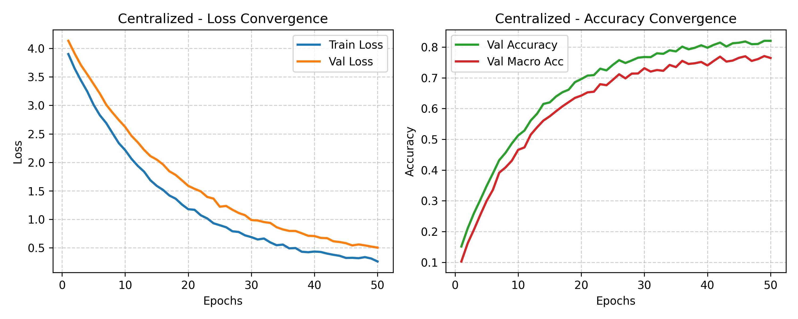
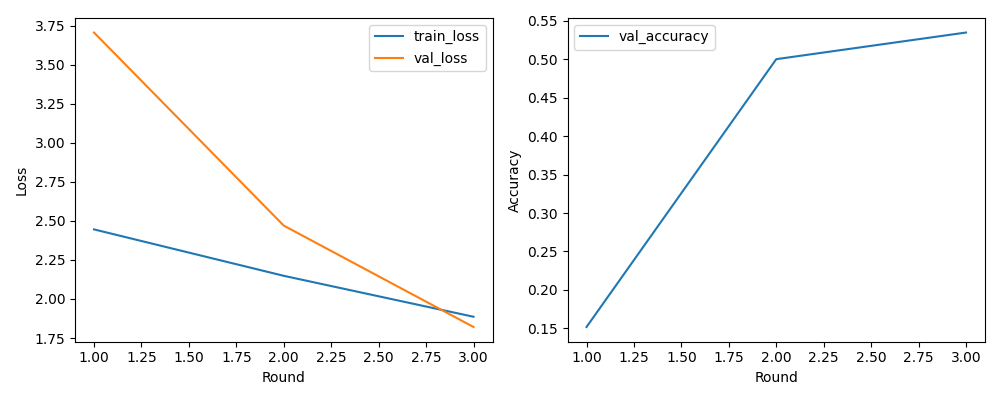
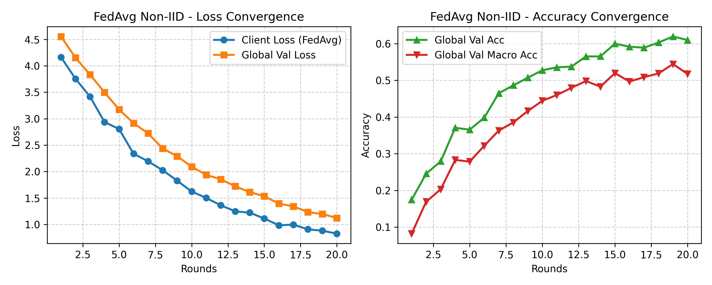
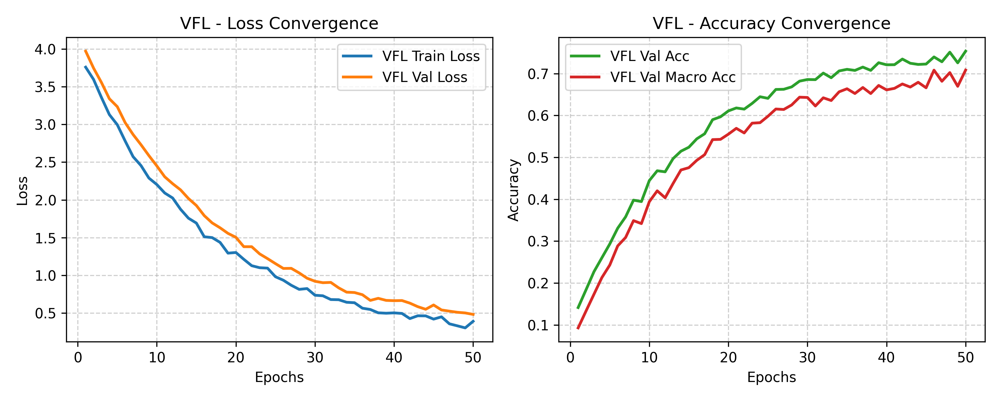
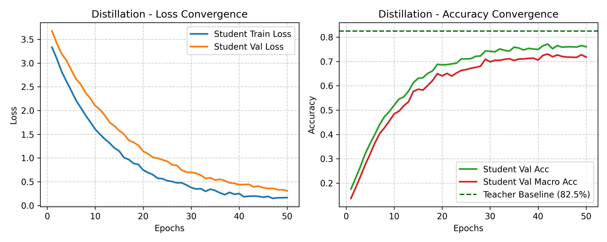

# PointFed3D

**Classification de nuages de points 3D avec FeaStNet : apprentissage centralisé, fédéré (horizontal et vertical) et distillation de connaissances.**

Mini-projet d'apprentissage fédéré, juin 2026. Le dépôt compare cinq stratégies d'entraînement sur un sous-ensemble de ShapeNet (via CAP3D, 50 classes, 1024 points par objet) avec l'architecture graphe **FeaStNet** (*Feature-Steered Graph Convolutional Networks*). L'algorithme **FedAvg** est implémenté entièrement à la main.

---

## Sommaire

1. [Résultats en un coup d'œil](#résultats-en-un-coup-dœil)
2. [Les cinq configurations](#les-cinq-configurations)
3. [Données et prétraitement](#données-et-prétraitement)
4. [Architecture FeaStNet](#architecture-feastnet)
5. [Installation](#installation)
6. [Utilisation](#utilisation)
7. [Structure du dépôt](#structure-du-dépôt)
8. [Analyse détaillée des résultats](#analyse-détaillée-des-résultats)
9. [Limites et pistes d'amélioration](#limites-et-pistes-damélioration)
10. [Documents du projet](#documents-du-projet)
11. [Auteur](#auteur)

---

## Résultats en un coup d'œil

| Configuration | Méthode | Paramètres | Compression | Accuracy test | Macro accuracy |
| --- | --- | ---: | ---: | ---: | ---: |
| **C1** | Baseline centralisée | 883 250 | 1,0× (réf.) | **82,54 %** | **79,63 %** |
| **C2** | Fédéré horizontal IID | 883 250 | 1,0× | 79,78 % | 76,81 % |
| **C3** | Fédéré horizontal non-IID | 883 250 | 1,0× | 64,21 % | 56,12 % |
| **C4** | Élève distillé (KD) | **114 620** | **7,7×** | 76,84 % | 73,25 % |
| — | Élève standard (sans KD) | 114 620 | 7,7× | 71,30 % | 67,45 % |
| **VFL** | Fédération verticale | 454 320 | 1,9× | 75,62 % | 72,08 % |

Points clés :

- La baseline centralisée fixe la borne supérieure à **82,54 %**.
- FedAvg en IID ne perd que **2,76 points** par rapport au centralisé.
- En non-IID (clients à classes disjointes), l'accuracy chute à **64,21 %**.
- La distillation apporte **+5,54 points** à l'élève et le rend **7,7× plus léger** que l'enseignant.
- Le VFL atteint **75,62 %** sans qu'aucune donnée brute ne quitte son propriétaire.

---

## Les cinq configurations

| Code | Description |
| --- | --- |
| **C1** | Baseline centralisée : toutes les données sont regroupées sur un serveur unique. |
| **C2** | Fédéré horizontal IID : FedAvg sur 4 clients, chacun avec la même distribution de classes. |
| **C3** | Fédéré horizontal non-IID : FedAvg sur 4 clients dont les classes sont disjointes (spécialisations thématiques). |
| **C4** | Distillation de connaissances : un élève réduit est guidé par les prédictions douces de l'enseignant C1. |
| **VFL** | Fédération verticale : l'entité A détient la géométrie (XYZ), l'entité B l'apparence (RGB). |

### FedAvg implémenté à la main (C2 et C3)

À chaque ronde $t$, le serveur envoie le modèle global à chaque client $k$. Après entraînement local, chaque client renvoie ses paramètres $w_k^{(t)}$ et la taille de sa partition $n_k$. Le serveur agrège clé par clé le `state_dict` :

$$
w^{(t+1)} = \sum_{k=1}^{K} \frac{n_k}{n}\, w_k^{(t)}, \qquad n = \sum_{k=1}^{K} n_k
$$

Deux types de paramètres sont traités :

- les **paramètres appris** (poids, biais, noyaux FeaStConv), moyennés avec pondération par taille d'échantillon ;
- les **buffers de BatchNorm** (`running_mean`, `running_var`), également moyennés de façon pondérée pour que le modèle global reflète la distribution statistique unifiée.

Entraînement fédéré : 4 clients, 20 rondes de communication.

### Scénario non-IID (C3)

Chaque client est affecté à un domaine exclusif et ne voit jamais les classes des autres :

| Client | Domaine |
| --- | --- |
| 1 | Mobilier |
| 2 | Transport |
| 3 | Technologie |
| 4 | Domestique |

### Fédération verticale (VFL)

1. **Entité A** passe les positions XYZ dans 3 couches FeaStConv sur un graphe k-NN géométrique, puis un pooling global, et produit un embedding $e_A \in \mathbb{R}^{128}$.
2. **Entité B** passe les couleurs RGB dans un MLP à 3 couches, puis un pooling global, et produit $e_B \in \mathbb{R}^{128}$.
3. Le **serveur** concatène $[e_A \,\|\, e_B] \in \mathbb{R}^{256}$ et applique un réseau dense pour prédire les classes.
4. Les gradients sont renvoyés du serveur vers chaque encodeur local pour la rétropropagation.

Garanties de confidentialité : seuls les embeddings circulent (aucune donnée brute, aucun poids partagé), et le pooling spatial introduit une perte d'information qui empêche de reconstruire les $1024 \times 3$ coordonnées d'origine à partir d'un vecteur de dimension 128.

### Distillation de connaissances (C4)

La perte combine la cross-entropy et la divergence de Kullback-Leibler sur les distributions adoucies par une température $\tau$ :

$$
\mathcal{L} = (1-\alpha)\,\mathcal{L}_{CE}\big(y, \sigma(z_s)\big) + \alpha\,\tau^2\,\mathcal{L}_{KL}\Big(\sigma\big(\tfrac{z_s}{\tau}\big),\, \sigma\big(\tfrac{z_t}{\tau}\big)\Big)
$$

Les logits de l'enseignant $z_t$ sont figés (`detach`). Réglages retenus : $\tau = 4{,}0$ et $\alpha = 0{,}5$.

---

## Données et prétraitement

**Source** : ShapeNet via le projet CAP3D (52 476 objets 3D d'origine). Un sous-ensemble représentatif de **50 classes** est construit à partir de `labeled_dataset.csv`, qui sert de table de correspondance entre identifiants et labels.

**Reproductibilité** :

- splits fixes **70 % entraînement / 15 % validation / 15 % test** ;
- échantillonnage **stratifié** pour conserver les proportions de classes dans chaque split ;
- graine aléatoire `seed = 42` pour la sélection, l'échantillonnage et les partitions.

**Prétraitement** de chaque fichier `.ply` :

1. sous-échantillonnage fixe à **N = 1024 points** ;
2. centrage sur l'origine et mise à l'échelle dans une sphère de rayon unitaire ;
3. augmentation (entraînement uniquement) : rotation aléatoire d'angle $\theta \in [0, 2\pi]$ autour de l'axe vertical $Y$, et bruit gaussien $\epsilon \sim \mathcal{N}(0, 0{,}01)$ sur chaque coordonnée.

---

## Architecture FeaStNet

### Opérateur de convolution FeaStConv

Pour un nœud $i$ de caractéristiques $x_i$ et de voisinage $\mathcal{N}(i)$ :

$$
x'_i = b + \sum_{m=1}^{M} \frac{1}{|\mathcal{N}(i)|} \sum_{j \in \mathcal{N}(i)} q_m(x_i, x_j)\, W_m\, x_j
$$

Les coefficients de steering sont calculés dynamiquement par un softmax :

$$
q_m(x_i, x_j) = \frac{\exp\big(u_m^\top (x_i - x_j) + c_m\big)}{\sum_{l=1}^{M} \exp\big(u_l^\top (x_i - x_j) + c_l\big)}
$$

Les vecteurs $u_m$, les biais $c_m$ et les matrices $W_m$ sont appris conjointement. Le réseau peut ainsi associer chaque noyau à des arrangements spatiaux particuliers, sans ordre imposé sur les voisins.

### Graphe géométrique

Le graphe est construit à la volée par **k plus proches voisins** sur les seules coordonnées $(x, y, z)$ : $k = 16$ pour l'enseignant, $k = 12$ pour l'élève.

### Modèles

| | Enseignant | Élève |
| --- | --- | --- |
| Couches FeaStConv | 3 | 3 |
| Dimensions cachées | [64, 128, 256] | [32, 64, 64] |
| Têtes (M) | [4, 4, 8] | [2, 2, 4] |
| Pooling global | mean + max concaténés | mean + max concaténés |
| Classifieur | 512 → 256 → 50 | réduit |
| k (k-NN) | 16 | 12 |
| Paramètres | 883 250 | 114 620 |

### Hyperparamètres d'entraînement (C1)

- optimiseur Adam, taux d'apprentissage `1e-3`, weight decay `1e-4` ;
- dropout `0.3` ;
- 50 époques maximum, early stopping avec patience de 10 sur l'accuracy de validation.

---

## Installation

Le projet est développé sous Windows (PowerShell). Dépendances listées dans `requirements.txt`.

```powershell
python -m venv .venv
.\.venv\Scripts\Activate.ps1
python -m pip install --upgrade pip setuptools wheel
pip install -r requirements.txt
```

Équivalent Linux ou macOS :

```bash
python -m venv .venv
source .venv/bin/activate
python -m pip install --upgrade pip setuptools wheel
pip install -r requirements.txt
```

---

## Utilisation

### Données attendues

- `labeled_dataset.csv` à la racine : correspondance entre identifiants et labels (fourni).
- Les fichiers `.ply` à placer dans `data/raw/pointclouds/`, ou dans un chemin précisé dans la configuration.
- Les splits `train/val/test` et les partitions fédérées sont générés de façon reproductible (`seed = 42`).

### Lancer les expériences

Tous les scripts lisent la même configuration :

```powershell
# C1 : baseline centralisée (et enseignant de la distillation)
python scripts\train_centralized.py --config configs\feastnet_base.yaml

# C2 / C3 : apprentissage fédéré horizontal (FedAvg manuel)
python scripts\train_federated.py --config configs\feastnet_base.yaml

# C4 : distillation de connaissances (nécessite le modèle C1 entraîné)
python scripts\train_distillation.py --config configs\feastnet_base.yaml
```

Lance d'abord `train_centralized.py` : le modèle C1 sert d'enseignant pour la distillation. Le scénario IID ou non-IID et le nombre de clients ou de rondes se règlent dans `configs/feastnet_base.yaml`.

### Sorties

Les résultats sont écrits dans `outputs/` :

| Dossier | Contenu |
| --- | --- |
| `outputs/checkpoints/` | modèles sauvegardés |
| `outputs/figures/` | courbes de convergence |
| `outputs/logs/` | journaux d'entraînement |
| `outputs/reports/` | métriques et rapports (dont `cross_client_analysis.json`) |

---

## Structure du dépôt

```text
.
├── configs/                 # configurations YAML (feastnet_base.yaml)
├── data/
│   ├── raw/                 # fichiers .ply d'origine
│   ├── processed/           # données prétraitées
│   └── splits/              # splits train/val/test et partitions fédérées
├── notebooks/               # exploration et analyses
├── outputs/
│   ├── checkpoints/
│   ├── figures/
│   ├── logs/
│   └── reports/
├── scripts/                 # points d'entrée (centralisé, fédéré, distillation)
├── src/feastnet_fl/         # package : modèles, données, FedAvg, VFL, distillation
├── labeled_dataset.csv      # identifiants et labels
├── Rapport_Projet_FL.md     # rapport (version Markdown)
├── rapport.tex              # rapport (version LaTeX)
├── mini_project.pdf         # énoncé du mini-projet
├── pyproject.toml
├── requirements.txt
└── README.md
```

---

## Analyse détaillée des résultats

### C1 : baseline centralisée

La convergence est stable : la perte d'entraînement passe d'environ 4,15 à 0,15 et l'accuracy de validation atteint son plateau vers l'époque 42. Le modèle sépare bien les formes volumétriques distinctes (avions, voitures) mais reste sensible aux classes proches (par exemple bols et mugs).



### C2 : fédéré IID

Avec 4 clients à distribution homogène, FedAvg converge en 20 rondes à **79,78 %**, soit une perte de seulement 2,76 points par rapport au centralisé.



### C3 : fédéré non-IID

L'accuracy tombe à **64,21 %** (macro 56,12 %) et les courbes sont instables. Chaque client optimise vers un minimum local très différent, et la moyenne FedAvg écrase ces dérives.



**Analyse cross-client.** Sur les classes qu'un client n'a jamais vues localement, le modèle global n'atteint que **38,68 %** en moyenne (détail par client dans `cross_client_analysis.json`). Cela illustre l'oubli induit par la spécialisation excessive des clients.

### VFL

Le modèle partitionné converge de façon régulière et atteint **75,62 %**. La fusion tardive des embeddings géométriques et visuels au niveau du serveur reste efficace malgré l'isolement des encodeurs.



### C4 : distillation

À architecture identique (114 620 paramètres), l'élève passe de **71,30 %** sans distillation à **76,84 %** avec distillation, soit **+5,54 points**. L'écart avec l'enseignant C1 est de 5,7 points pour un modèle 7,7× plus léger, ce qui ouvre la voie à un déploiement sur carte embarquée.



### Arbitrages

1. **Confidentialité et performance** : le fédéré IID offre un excellent compromis, mais l'hétérogénéité des données (non-IID) dégrade fortement les résultats.
2. **Coût de calcul** : la distillation donne un modèle compact avec une perte d'exactitude limitée.
3. **Cloisonnement des attributs** : le VFL sépare physiquement géométrie et apparence tout en gardant une bonne précision.

---

## Limites et pistes d'amélioration

- **Non-IID** : FedAvg seul s'adapte mal aux distributions très hétérogènes. Des méthodes comme FedProx ou SCAFFOLD, ou la personnalisation par client, sont des pistes naturelles.
- **Confidentialité du VFL** : les garanties reposent sur la perte d'information du pooling. Aucune confidentialité différentielle ni agrégation sécurisée n'est appliquée.
- **Fédération simulée** : les clients sont simulés sur une même machine, sans coût de communication réel.
- **Distillation fédérée** : combiner KD et apprentissage fédéré (élève entraîné chez les clients) n'est pas traité ici.
- **Une seule graine** : les résultats portent sur `seed = 42`. Moyenner plusieurs graines donnerait des intervalles de confiance.

---

## Documents du projet

- [`Rapport_Projet_FL.md`](Rapport_Projet_FL.md) et [`rapport.tex`](rapport.tex) : rapport complet.
- [`mini_project.pdf`](mini_project.pdf) : énoncé du mini-projet.

---

## Auteur

**Jad Falaq**, élève ingénieur à l'ENSIAS (filière IA).
GitHub : [JadFalaq](https://github.com/JadFalaq)

Référence : Verma, Boyer, Verbeek, *FeaStNet: Feature-Steered Graph Convolutions for 3D Shape Analysis*, CVPR 2018.
